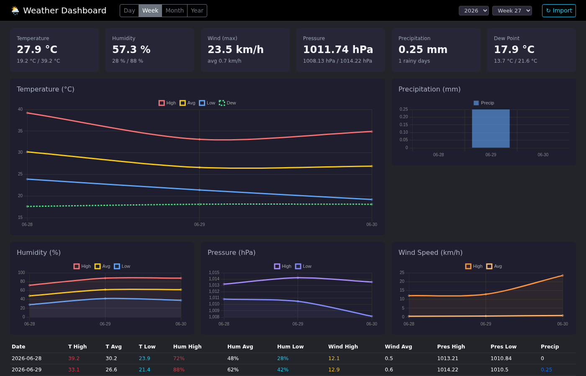

# 🌦 Weather Dashboard

A single-page dashboard for a personal weather station. Import the raw
export from your station, and browse temperature, humidity, wind, pressure,
precipitation and dew point across any time window — then compare your
readings against a public weather service.

Built entirely in **TypeScript** — Express on the back end and a compiled
TypeScript front end (no framework, no bundler). Storage is a local SQLite file
via Node's **built-in** `node:sqlite` module — no native addons, no database
server to run.



## Features

- **Flexible time windows** — view a single **Day**, **Week**, **Month**,
  **Year**, or a **custom Range** between any two recorded dates. The Range
  pickers only offer dates that actually exist in your data, and an **All**
  toggle spans the entire dataset in one click.
- **At-a-glance stats** — high/avg/low cards for every metric, plus totals
  like accumulated precipitation and the wettest day, plus a **Rain Days** card
  counting the days with any precipitation in the selected window (with their
  share of the days that have data, and the dry-day count).
- **Climate days and spells** — MeteoSwiss frost/ice days (low / high below
  0 °C) and summer/hot days (high of 25 / 30 °C or more), plus the longest run
  of consecutive wet and dry days in the window (hover the card for the dates).
- **Calendar heatmap** — for a Year or a multi-month Range, one cell per day
  coloured by temperature (diverging around the period's mean) or precipitation;
  click a day to open it.
- **Missing-day indicator** — beside the chart toggles, how many days of the
  selected period have no reading (hover for the dates). The period is clipped
  to the span the station has records for, so days before the first reading or
  not yet imported don't count as gaps.
- **Interactive charts** — temperature, precipitation, humidity, pressure and
  wind rendered with Chart.js.
- **Compare vs. a public station** — overlay your readings against
  [Open-Meteo](https://open-meteo.com/) data for a reference location
  (Baar, CH by default) with a per-metric difference summary, plus Baar's
  **1991–2020 long-term daily normal** (from Open-Meteo's ERA5 archive,
  downloaded once and cached) so a period reads as warmer, colder, wetter or
  drier than usual — for your station and for Baar.
- **Across Years** — the same day, week or month compared year over year, with
  a dashed mean-of-years baseline on every chart and a year-to-date
  precipitation chart overlaying each year's running rain total. Each year's
  column says how many of the period's days it recorded (e.g. `11/30 days`),
  and a partial period is flagged, so a half-recorded month can't pass for a
  like-for-like comparison.
- **One-click re-import** — drop in a fresh station export and hit **↻ Import**;
  ingestion is idempotent, so re-importing never duplicates rows.

## Requirements

- **Node.js 22 or newer** (development uses Node 24). This is required for the
  built-in `node:sqlite` module — the app does **not** use better-sqlite3 or
  any native addon.

## Getting started

```bash
npm install
npm run dev
```

Then open **http://localhost:3000**. The server auto-imports `weather_data.txt`
on startup, so the dashboard lands on populated data immediately.

Set `PORT` to bind a different port:

```bash
PORT=8080 npm run dev
```

## Scripts

| Command | What it does |
| --- | --- |
| `npm run dev` | Compile the front end, then run the server with `ts-node` → http://localhost:3000 |
| `npm run build` | Compile the server (`src/` → `dist/`) and the client (`src/client/app.ts` → `public/app.js`) |
| `npm run build:client` | Compile only the front end → `public/app.js` |
| `npm start` | Run the compiled server (`node dist/server.js`; requires `build` first) |
| `npm run import` | Re-parse `weather_data.txt` into `weather.db` from the CLI |
| `npm run screenshot` | Run the Playwright verification harness (server must be up) |
| `npm test` | Type-check and run the unit and route tests (`node:test`, offline, throwaway databases) |

## Data format

Weather readings live in `weather_data.txt`, a tab-separated export with a
title line, two header rows, then one row per day. Dates are `MM/DD/YYYY`, and
each row carries 16 columns: high/avg/low for temperature, dew point, humidity
and wind speed, high/low for pressure, and a precipitation sum.

Importing is **idempotent** — rows are keyed on their unique `date` via
`INSERT OR REPLACE`, so re-running an import updates existing days rather than
duplicating them. Replace the file with your own station's export and either
restart the server or click **↻ Import** in the UI.

## API

The front end is a thin client over these routes; each period route returns
`{ rows, stats, coverage }` — `coverage` is `{ expected, recorded, missing }`, the period's gaps.

| Route | Description |
| --- | --- |
| `GET /api/day?date=YYYY-MM-DD` | A single day |
| `GET /api/week?year=&week=` | An ISO week |
| `GET /api/month?year=&month=` | A calendar month |
| `GET /api/year?year=` | A full year |
| `GET /api/range?from=&to=` | Any inclusive date range |
| `GET /api/compare?from=&to=` | Your data aligned with Open-Meteo for the reference location |
| `GET /api/across-years?unit=&…` | The same day, week or month gathered from every year, each with its recorded vs calendar day count |
| `GET /api/precip-ytd` | Each year's running precipitation total, one point per recorded day |
| `GET /api/dates` | All available dates |
| `GET /api/status` | Last import time + record count |
| `POST /api/import` | Re-import `weather_data.txt` (idempotent) |

## Project layout

```
src/
  db.ts          SQLite access (node:sqlite), period windows, stat aggregation
  dates.ts       Date helpers shared by the query layer and the routes
  normals.ts     Reduces 30 years of daily data to one long-term normal per calendar day
  import.ts      Parses weather_data.txt → weather.db
  server.ts      Express routes over db.ts
  *.test.ts      Unit and route tests (node:test)
  test/
    helpers.ts   Test setup: points each test file at a throwaway database
  client/
    app.ts       All UI state, charts, and the three views — no framework
public/
  index.html     Dashboard markup (Bootstrap + Chart.js from CDN)
  app.js         Compiled from src/client/app.ts (generated, git-ignored)
  style.css      Dark-theme styling
screenshot.ts      Playwright verification harness
weather_data.txt   Raw station export (the import source)
weather.db         SQLite database (generated)
```

**Everything is TypeScript.** The front end compiles from `src/client/app.ts`
to `public/app.js` with `tsc` (no bundler); `public/` is otherwise served as-is
with Bootstrap / Chart.js from a CDN. After editing `src/client/app.ts`, run
`npm run build:client` (or restart `npm run dev`, which does it) and refresh the
browser. After editing anything under `src/`, restart the dev server. Editing
`public/index.html` or `public/style.css` only needs a browser refresh.

## Verification

`npm test` runs the unit and route tests — stats, spells, climate days,
coverage, the importer, the long-term normals and the API routes — with Node's
built-in `node:test`, each file against its own throwaway database and with no
network. `screenshot.ts` is the end-to-end verification harness: it drives the
running server with Playwright, asserts every period renders with populated
stat cards, checks the Year period draws the calendar heatmap and Across Years
draws the year-to-date rain chart and labels each year with its recorded day
count, captures screenshots, and **exits non-zero** on any console error, page
error, failed same-origin request, or stat card that never fills in.

```bash
npx playwright install chromium   # once
npm run dev &                     # server must be up first
npm run screenshot                # writes dashboard.png / -month / -year / -yoy .png
```

Set `PLAYWRIGHT_CHROMIUM_PATH` to reuse an already-installed browser (handy
where Playwright's download CDN is unreachable), and `DASHBOARD_URL` to point at
something other than `http://localhost:3000`.

### CI

`.github/workflows/ci.yml` runs on every push and PR to `main`, on Node 24:
the TypeScript-only rule is enforced against tracked files, `npm run build`
type-checks server and client, `npm test` runs the unit and route tests,
`npm run import` re-parses the committed
`weather_data.txt`, and the harness above runs against a live server. The
screenshots are uploaded as a build artifact, so you can eyeball a UI change
straight from the PR.
